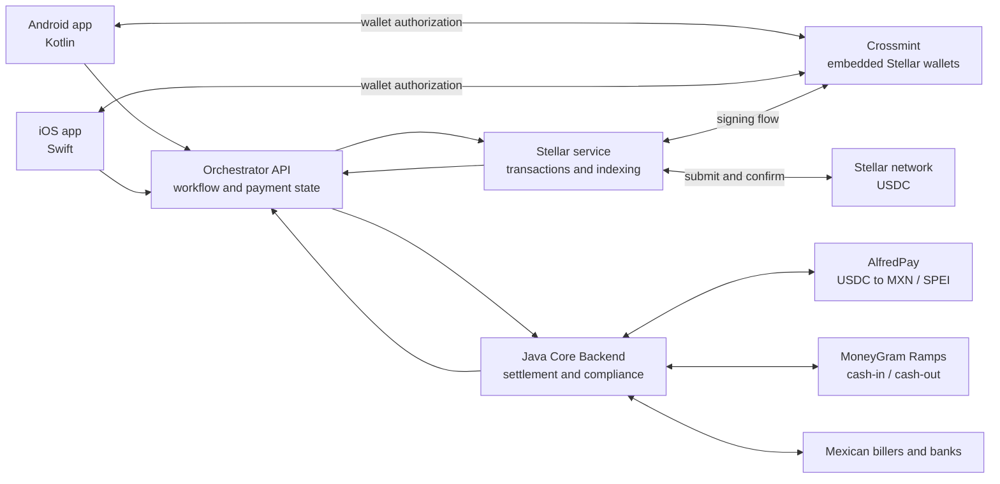

# Saldo Stellar USDC Architecture

Saldo is integrating Stellar USDC into its native Android and iOS applications and Mexican bill-payment infrastructure.

Users will be able to create an embedded Stellar wallet, hold and transfer USDC, pay supported Mexican bills, convert USDC to MXN through AlfredPay, and access MoneyGram cash-in/cash-out flows. Every payment is linked across Stellar and offchain settlement systems for reconciliation, support, and compliance.

**SCF #46 request:** $122,900

**Production pilot target:** May 31, 2027

## Architecture

### System Responsibilities

- **Android and iOS:** wallet onboarding, USDC balance, send, receive, history, bill payment, cash ramps, and recovery.
- **Crossmint:** embedded wallet provisioning, transaction authorization, and wallet recovery.
- **Orchestrator API:** canonical user workflow, payment state, idempotency, and cross-system references.
- **Stellar service:** account setup, transaction construction, submission, confirmation, indexing, and onchain monitoring.
- **Java Core Backend:** AlfredPay, MoneyGram, billers, banks, KYC/AML, screening, refunds, and disputes.

Each operation starts with a unique Saldo payment ID and records the applicable wallet address, Stellar hash and ledger, partner transaction IDs, settlement references, compliance state, timestamps, and exception or refund links.

## Wallet Security

The target wallet model uses a device-held Crossmint signer and user-controlled recovery, with no Saldo server signer on user wallets. Final custody classification and backend authority depend on the production Crossmint signer and recovery configuration and must be confirmed before mainnet rollout.

See [wallet authorization, signing, and recovery](docs/wallet-security.md).

## Delivery

| Tranche | Amount | Deliverable | Target |
| --- | ---: | --- | --- |
| 1 | $31,000 | Mobile Stellar wallet MVP | January 31, 2027 |
| 2 | $44,000 | Bill payments, partner integrations, reconciliation, and security | March 31, 2027 |
| 3 | $47,900 | Mainnet mobile production pilot | May 31, 2027 |
| **Total** | **$122,900** |  |  |

The mainnet pilot targets:

- At least **$5,000** in eligible Stellar USDC volume.
- At least **100** successful Stellar USDC transactions.
- At least **25** unique active Stellar wallets.

The calculation method and reviewer-executable tests are defined in [acceptance tests and mainnet metrics](docs/acceptance-tests.md).

## Documentation

- [Technical architecture](docs/architecture.md)
- [Components and responsibilities](docs/components.md)
- [Transaction flows](docs/flows.md)
- [Crossmint, AlfredPay, MoneyGram, and Stellar integrations](docs/integrations.md)
- [Wallet security](docs/wallet-security.md)
- [Reconciliation architecture](docs/reconciliation.md)
- [STRIDE threat model](docs/threat-model.md)
- [Onchain and operational monitoring](docs/onchain-monitoring.md)
- [Acceptance tests and mainnet metrics](docs/acceptance-tests.md)
- [Roadmap and budget](docs/roadmap.md)
- [Scope and dependency status](docs/scf46-scope.md)
- [Repository and responsibility inventory](docs/repositories.md)
