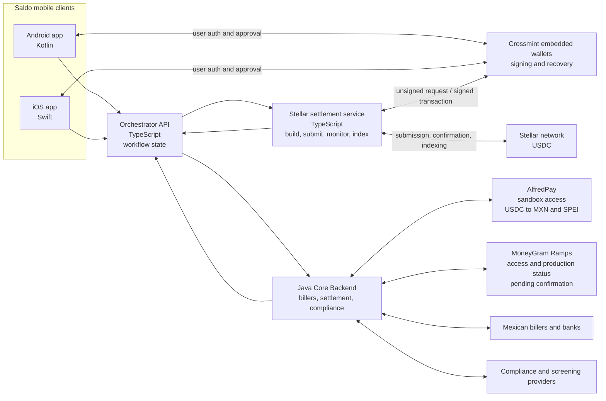

# Saldo Stellar USDC Architecture — SCF #46

This repository documents Saldo's revised SCF #46 Integration Track submission: integrating Stellar USDC into Saldo's existing native Android and iOS applications and existing bill-payment infrastructure.

**Funding request:** $122,900. **Delivery target:** May 31, 2027.

## Funded Scope

The funded work covers:

- Native Android (Kotlin) and iOS (Swift) wallet experiences.
- Crossmint embedded Stellar wallet provisioning, authorization, signing, and recovery.
- Stellar USDC balance, receive, send, transaction history, account activation, indexing, and reconciliation.
- Existing TypeScript Orchestrator API, TypeScript Stellar settlement service, and Java Core Backend.
- USDC-funded Mexican bill payments, AlfredPay USDC-to-MXN/SPEI settlement, and MoneyGram Ramps cash-in/cash-out.
- KYC/AML eligibility, sanctions and risk screening, failed settlement, refunds, disputes, monitoring, and audit evidence.

The following are **not funded by SCF #46**: agent liquidity or credit limits, agent-facing web dashboards, web-wallet signing, Stellar Wallets Kit, Circle CCTP, cross-chain funding, DeFindex, Visa prepaid cards, lending, and credit products. The public `saldo_web` prototype remains in the [repository inventory](docs/repositories.md) as historical evidence only.

See [SCF #46 scope and evidence status](docs/scf46-scope.md) for the complete boundary between existing infrastructure, proposed work, dependencies, and open decisions.

## Target Architecture

The Orchestrator owns the canonical user workflow and payment state. The Stellar settlement service owns Stellar transaction construction, submission, confirmation, and indexing, but it may not bypass the configured Crossmint signing authority. The Java Core Backend owns partner, biller, banking, and compliance execution.

## Wallet Authority Status

Crossmint is the sole selected embedded-wallet provider. Crossmint documentation supports device signers, user-controlled recovery factors, server signers, and Stellar wallets, but custody depends on the exact signer and recovery configuration. Saldo's proposed design uses a device-held signer and user-controlled recovery method; no Saldo backend signer is proposed for user wallets.

Whether that design is supported end-to-end by the exact Crossmint Stellar Kotlin and Swift SDK versions, and whether any tenant-level or support recovery path can authorize fund movement, is **Pending technical confirmation**. Until the configuration and threat review are complete, this repository does not classify the wallet as noncustodial and does not claim that Saldo is unable to move user funds.

See [wallet security](docs/wallet-security.md) for verified facts, proposed design, open decisions, and platform differences.

## Delivery And Verification

| Tranche | Amount | Deliverable | Target |
| --- | ---: | --- | --- |
| 1 | $31,000 | Mobile Stellar wallet MVP | January 31, 2027 |
| 2 | $44,000 | Bill payments, partners, reconciliation, and security | March 31, 2027 |
| 3 | $47,900 | Mainnet mobile production pilot | May 31, 2027 |
| **Total** | **$122,900** |  |  |

Mainnet acceptance requires at least $5,000 cumulative eligible Stellar USDC volume, 100 successful eligible transactions, and 25 unique active wallets. Definitions, exclusions, evidence queries, and reviewer-executable tests are in [acceptance tests](docs/acceptance-tests.md).

## Documentation

- [Scope and evidence status](docs/scf46-scope.md)
- [Technical architecture](docs/architecture.md)
- [Components and ownership](docs/components.md)
- [Transaction flows](docs/flows.md)
- [Partner integrations](docs/integrations.md)
- [Wallet security](docs/wallet-security.md)
- [Reconciliation](docs/reconciliation.md)
- [STRIDE threat model](docs/threat-model.md)
- [Onchain monitoring](docs/onchain-monitoring.md)
- [Acceptance tests and metrics](docs/acceptance-tests.md)
- [Repository and responsibility inventory](docs/repositories.md)
- [Roadmap and budget](docs/roadmap.md)
- [Diagram status](diagrams/README.md)

## Evidence Labels

- **Verified:** supported by accessible repository evidence or linked official documentation.
- **Proposed:** target design to be delivered under SCF #46; not a claim of completed implementation.
- **Pending technical confirmation:** configuration, access, behavior, or approval cannot yet be independently verified.
- **Partner dependency:** controlled by Crossmint, AlfredPay, MoneyGram, a biller, bank, or compliance provider.
