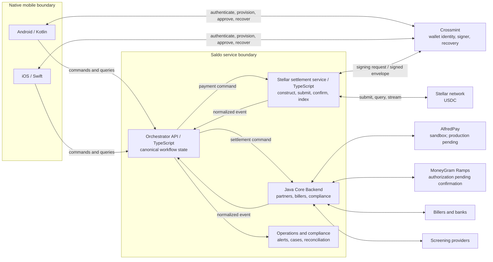

# Technical Architecture

## Design Principle

Saldo uses a ledger-first orchestration model. Native mobile clients initiate user actions; the Orchestrator creates the Saldo payment ID and owns workflow state; specialized services execute Stellar and offchain work. A provider callback never becomes canonical merely because it arrived last.

All capability descriptions below are target architecture unless explicitly labeled existing or verified.

## Existing Boundaries Preserved

- **Android and iOS:** existing native application boundaries; repository contents were not accessible during this review.
- **Orchestrator API:** existing architectural boundary for workflow and transaction state; implementation location is pending confirmation.
- **Stellar settlement service:** existing TypeScript service boundary; private repository access was unavailable.
- **Java Core Backend:** existing integration boundary for billers, banks, settlement partners, and compliance; private repository access was unavailable.

SCF #46 extends these boundaries. It does not replace the existing payment platform or introduce a funded web-client architecture.

## Trust And Authorization Boundaries

1. The mobile app authenticates the Saldo user and obtains a short-lived Saldo session.
2. Crossmint authentication or a configured identity-provider JWT binds the user session to a Crossmint wallet identity.
3. The Orchestrator maps an immutable Saldo user ID to the Crossmint wallet locator and Stellar address; email and phone are mutable attributes, not primary keys.
4. The Stellar service constructs a transaction from server-validated amount, destination, asset allowlist, memo, fee, and time bounds.
5. The configured Crossmint signer authorizes the transaction. The proposed design requires user-controlled signing for user-wallet debits.
6. The Stellar service submits only an envelope whose fields match the approved payment record, then monitors final inclusion.
7. The Java backend starts offchain settlement only after required compliance and onchain preconditions are met.

The exact deployed Crossmint signer and recovery configuration is **Pending technical confirmation**. No custody conclusion is valid until the signer inventory and recovery authority are exported and tested. See [wallet security](wallet-security.md).

## State Ownership

| State | Authoritative owner | Evidence |
| --- | --- | --- |
| Saldo user/payment workflow | Orchestrator | Payment record and append-only transition log |
| Wallet signer/recovery configuration | Crossmint plus onchain wallet state | Wallet/signer identifiers and configuration export |
| Stellar submission and confirmation | Stellar settlement service | Envelope hash, transaction hash, ledger sequence, result code |
| Onchain truth | Stellar network | Public ledger transaction and operations |
| AlfredPay/SPEI execution | Java Core Backend | Quote, partner transaction ID, SPEI reference, status payload |
| MoneyGram execution | Java Core Backend | Provider transaction ID, status, reference number, cash event |
| Biller settlement | Java Core Backend | Biller reference and acknowledgement |
| Compliance decision | Java Core Backend/compliance system | Decision ID, rule outcome, reviewer/case reference |

Only the Orchestrator may transition the user-visible aggregate payment state. Other services emit immutable, deduplicated facts.

## Failure Boundary

Onchain and offchain settlement are not atomic. The system therefore uses a saga with explicit compensating actions:

- If signing or Stellar submission fails, do not initiate offchain settlement.
- If Stellar succeeds but the offchain leg fails, move to `EXCEPTION_REVIEW`; retry only when the partner operation is provably idempotent.
- If a refund is approved, create a separate linked refund payment ID; never rewrite the original transaction as if it did not occur.
- If an offchain leg reports success without the expected onchain state, freeze automated progression and open an operations case.

Detailed transitions and invariants are in [reconciliation](reconciliation.md).

## Data And Credential Boundaries

- Mobile clients receive public client configuration only; server API secrets never ship in an app bundle.
- Crossmint, AlfredPay, MoneyGram, screening, and bank credentials are stored in a managed secrets service with environment separation, least privilege, rotation, and access audit.
- Provider payloads are schema-validated and stored with sensitive fields redacted or tokenized.
- Personally identifiable data is excluded from Stellar memos and public transaction metadata.
- Logs correlate by Saldo payment ID and provider references, not raw identity attributes.

## Deployment Gates

Testnet/sandbox completion does not authorize mainnet. Production requires completed signer/recovery threat tests, Crossmint Stellar enablement, pinned USDC identifiers, partner onboarding/certification, compliance approval, runbooks, alert ownership, reconciliation dry runs, and rollback/incident exercises.
