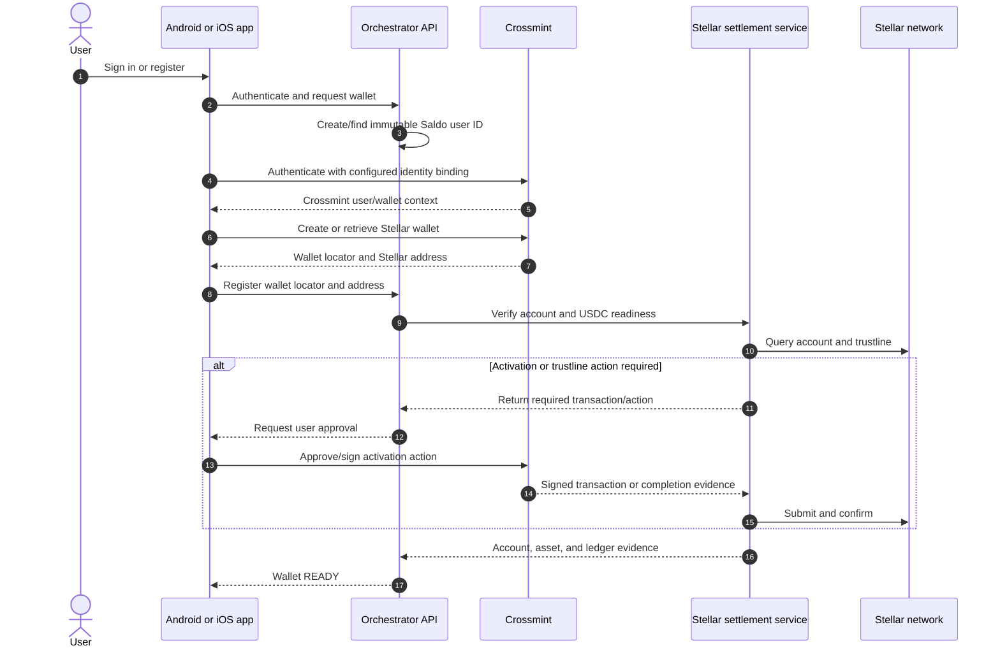
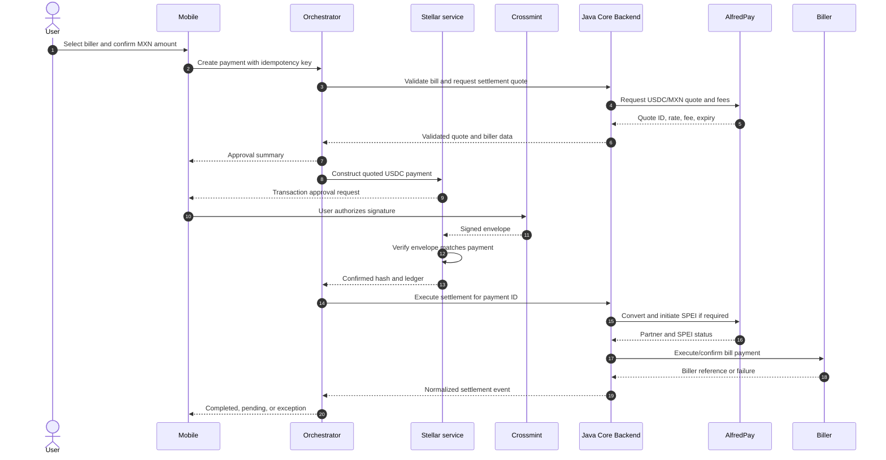

# Transaction Flows

All flows are proposed SCF #46 behavior unless an evidence label says otherwise.

## Signup And Wallet Provisioning

The app must not display `READY` until identity mapping, account activation, network, and USDC asset checks pass. The party funding base reserve or sponsoring account/trustline entries is **Pending technical confirmation**.

## Send Or Receive USDC

### Send

1. Mobile submits destination, amount, and idempotency key.
2. Orchestrator validates session, wallet ownership, KYC/AML eligibility, limits, asset/network, and destination; it creates the Saldo payment ID.
3. Stellar service builds a time-bounded transaction and returns an approval summary.
4. Mobile displays source, destination, exact USDC amount, fee, network, and expiry.
5. Crossmint applies the configured signer authorization.
6. Stellar service compares the signed envelope with the approved payment record, submits it, and confirms ledger inclusion.
7. Orchestrator moves the payment to `COMPLETED` only after the confirmed event is indexed.

### Receive

The app displays the confirmed Stellar address and network plus an explicit USDC asset warning. The indexer records eligible incoming USDC operations and associates them with a pilot user. Unsolicited or unsupported assets are shown separately and never counted as SCF USDC volume.

## New-Device Recovery

1. User authenticates on a new device.
2. App retrieves the existing wallet identity; it must not silently create a second wallet.
3. Crossmint indicates that no usable device signer is present.
4. User proves control of the configured recovery method.
5. Crossmint authorizes enrollment of the new device signer and, if policy requires, removal of the lost signer.
6. Orchestrator records a recovery event without storing OTPs, secrets, or recovery tokens.
7. A cooling period or enhanced verification applies to high-risk recovery followed by transfer.
8. A small test transaction proves authorization before normal limits are restored.

This uses Crossmint recovery infrastructure, not SEP-30. Whether the exact Stellar mobile configuration supports this sequence and which actors can invoke each step is **Pending technical confirmation**.

## USDC-Funded Bill Payment

If the quote expires before signing, the transaction is not submitted; a new quote and user approval are required. If the onchain leg confirms and an offchain leg fails, the payment moves to exception handling rather than automatic blind retry.

## AlfredPay Failure And Refund

1. Java backend verifies callback authentication or obtains status by authenticated polling.
2. It deduplicates the provider event and links it to the Saldo payment ID and AlfredPay transaction ID.
3. A retryable pending state uses bounded backoff until the provider SLA expires.
4. A terminal failure after confirmed Stellar debit opens `EXCEPTION_REVIEW`.
5. Operations determine whether to retry the same idempotent partner operation, pay through an approved recovery path, or refund.
6. A refund uses a new payment ID linked by `refund_of_payment_id`, requires authorization and screening, and records its own Stellar hash.

## MoneyGram Cash-In/Cash-Out

MoneyGram currently documents both a widget/API flow for new Stellar pilots and a legacy SEP-10/SEP-24 anchor flow. Saldo must select and certify one path; it must not mix protocol steps from both in an implementation claim.

### Common Flow

1. Mobile asks the Orchestrator to create a cash transaction.
2. Java backend creates the MoneyGram session or anchor transaction and stores the provider ID before opening the interactive URL.
3. Mobile opens only an allowlisted HTTPS MoneyGram origin in an in-app browser/webview and validates the return link.
4. User completes provider KYC and cash instructions.
5. For cash-out, the app requests user authorization for the exact Stellar USDC transfer, destination, and required memo; for cash-in, the indexer waits for the inbound USDC transaction.
6. Java backend consumes authenticated callback data if available and polls authoritative status as a fallback.
7. Orchestrator reconciles provider ID, MoneyGram reference, transaction hash, amount, wallet, and terminal status.

For the legacy path, SEP-10 authentication precedes SEP-24 deposit/withdraw and the SEP-24 transaction ID is polled. For the current widget/API path, a server-created short-lived session and sign callback are used; the widget handles anchor interaction. Exact credentials, supported corridors, callbacks, certification, and production authorization are **Pending technical confirmation**.

## Disputes And Inconsistent State

- The original ledger evidence is immutable.
- Support opens a case linked to the payment ID and records user claim, provider evidence, and decision.
- Automated execution stops for impossible state combinations, amount mismatch, unknown destination, duplicate external reference, or success reversal.
- Resolution is an explicit transition such as `RESOLVED_NO_ACTION`, `REFUND_PENDING`, `REFUNDED`, or `LOSS_RECORDED`, never an edit that hides the original event.
